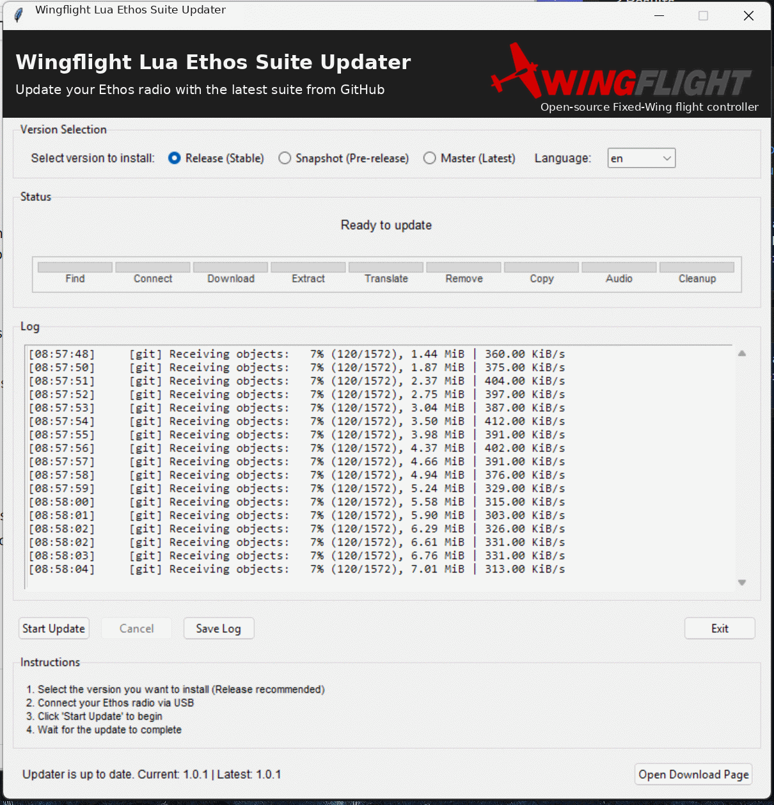

# Wingflight Radio Updater

Desktop updater for the [Wingflight Lua suite for Ethos](https://github.com/WingFlight/wingflight-lua-ethos-suite).
It downloads the suite and copies it onto a FrSky Ethos radio connected by USB, on Windows, macOS
and Linux.

For EdgeTX and OpenTX radios, use the
[Wingflight EdgeTX/OpenTX Lua Updater](https://github.com/WingFlight/wingflight-lua-edgetx-updater).

## Download

Download the zip for your system from the
[releases page](https://github.com/WingFlight/wingflight-lua-ethos-suite-updater/releases):

- Windows: `wingflight-lua-ethos-suite-updater-<version>-windows-<arch>.zip`
- macOS: `wingflight-lua-ethos-suite-updater-<version>-macos-<arch>.zip`
- Linux: `wingflight-lua-ethos-suite-updater-<version>-linux-<arch>.zip`

A release that has no updater files was made without rebuilding the updater. Use the most recent
release that has them.

After updating, turn the suite on for your model as described in
[Installing the Lua Suite](https://doc.wingflight.org/ethos-suite/installing/).

## Developer Notes

Compilation requirements:

1. Windows build host (PyInstaller target).
2. Python 3.x on PATH.
3. PyInstaller installed: `pip install pyinstaller`
4. From `src`, run: `make.cmd`
5. Output EXE: `wingflight-lua-ethos-suite-updater.exe`

Optional build inputs:

- `src/icon.ico` (embedded icon used by `make.cmd`)

## macOS / Linux Notes

- The updater uses `tkinter` for the GUI. Ensure your Python install includes Tk support.
  - macOS: the python.org installer typically includes Tk.
  - Linux: install your distro's `python3-tk` package.
- HID support is optional. If `hid`/`hidapi` is missing, the updater can still work
  when the radio is already mounted in storage mode.
- For development runs on macOS/Linux, use:
  - `src/run_updater.sh`
- macOS icon: generate `icon.icns` from the Windows `.ico` with:
  - `python3 src/build_icon_icns.py`
